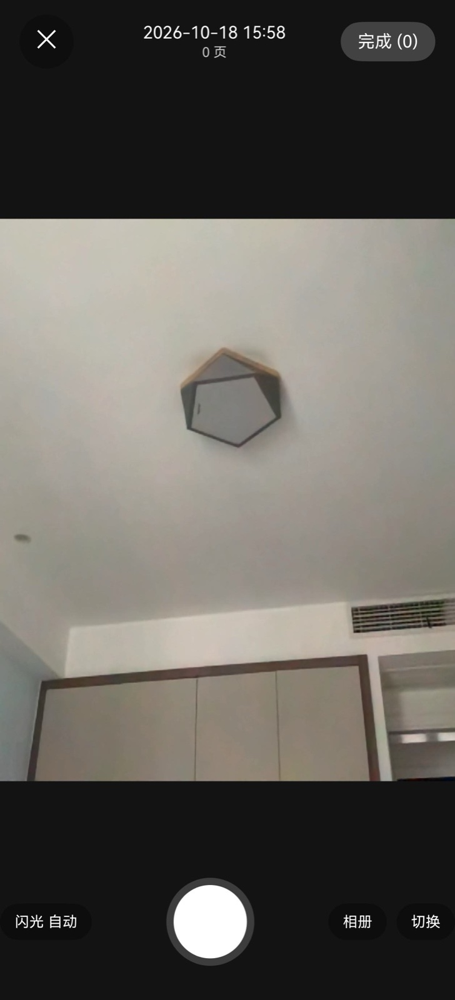
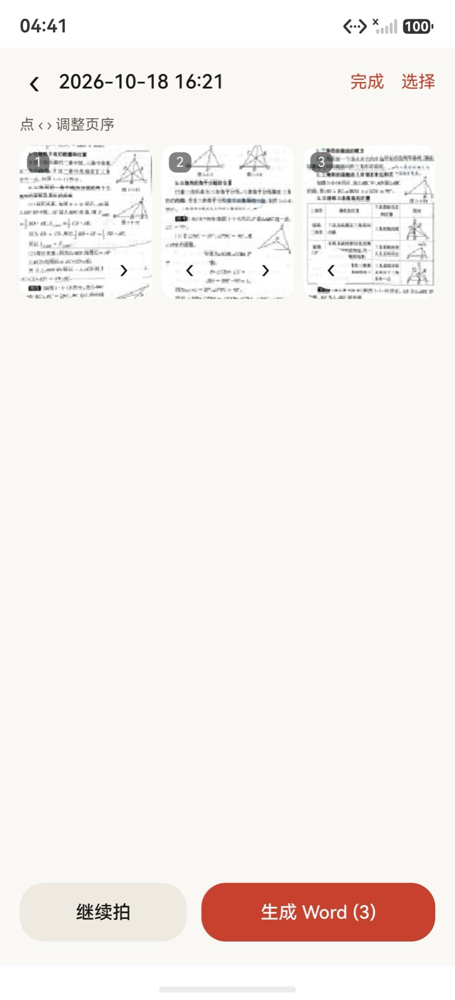
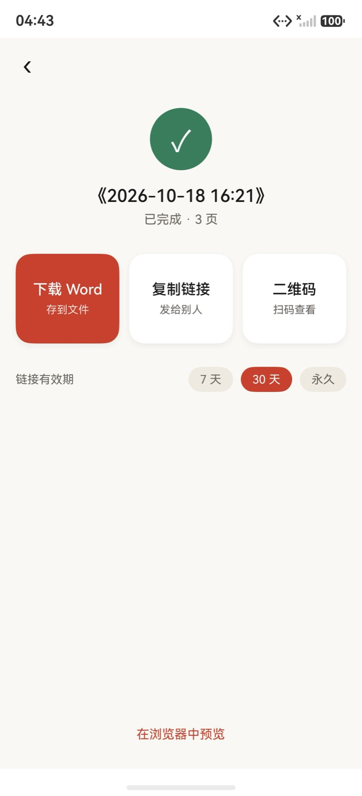
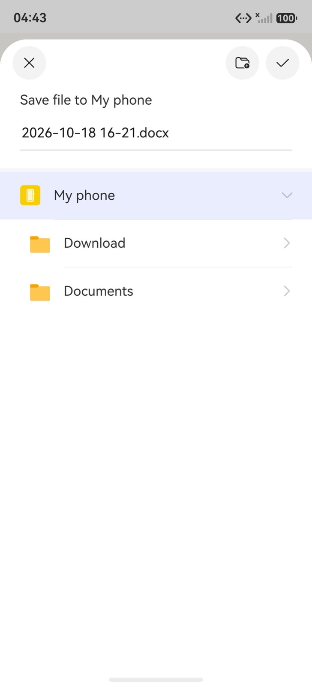
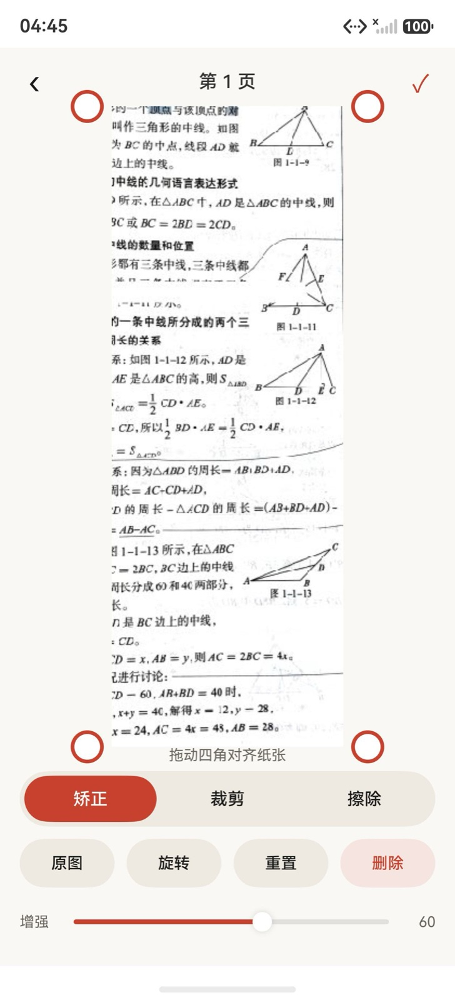
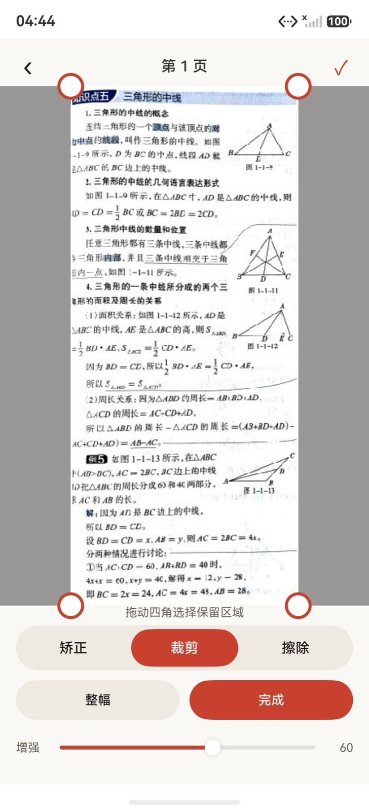
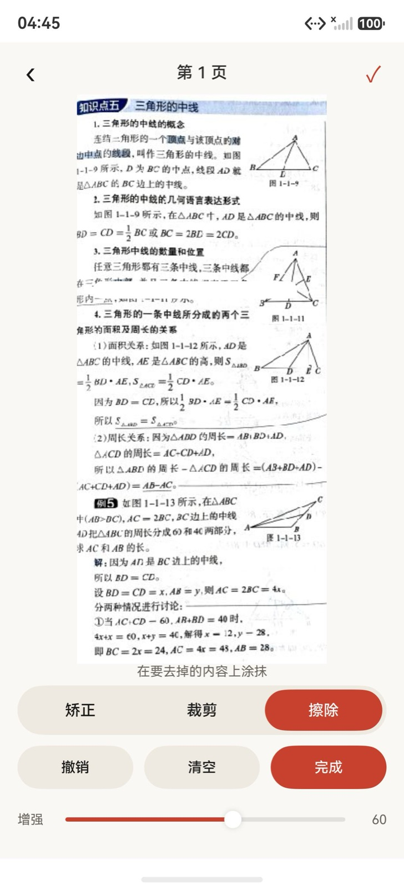

# 拾页 / Shiye

> 拍完即成篇。

连续拍摄多页纸质文档 → 端侧透视矫正与去阴影 → 百度 PaddleOCR 识别 → 生成 Word，并给出一个能在浏览器里查看、分块复制的预览链接。

## 组成

| 目录 | 内容 |
| --- | --- |
| `app/` | HarmonyOS 客户端（ArkTS + ArkUI V2），支持 HarmonyOS 6 / 7 |
| `server/` | Rust 服务端（axum + tokio + SQLite），`#![forbid(unsafe_code)]` |
| `deploy/` | OpenRC 服务脚本、Caddy 反代模板、部署环境变量示例 |
| `.agent/` | 设计与实施计划（文件名前缀 `YYYYMMDDHHMM-`） |

## 文档

- 设计基线：[`.agent/202610181212-design.md`](.agent/202610181212-design.md)
- 实施计划：[`.agent/202610181212-plan.md`](.agent/202610181212-plan.md)

## 接口前缀

所有对外路由都在 `/shiye` 下，前缀由 `config.toml` 的 `base_path` 控制：

```
/shiye/healthz              探活（不鉴权）
/shiye/api/v1/*             客户端 API（X-Device-Id 鉴权）
/shiye/s/{token}            分享页（token 鉴权，只读）
```

## 身份与多用户隔离

目前没有登录，**每台设备一个随机 UUID 就是身份**：

- 客户端首次启动生成 UUIDv4（122 bit，`util.generateRandomUUID`），存 preferences，此后每次请求带 `X-Device-Id`；
- 服务端只接受合法 UUID，并统一转小写（同一台设备不会因为大小写分裂出两份数据），缺失/非法一律 401；
- `/api/v1/*` 的每条查询都带 `device_id` 过滤；访问别人的组/页一律 **404**（不返回 403，避免暴露「存在但无权」）；
- 分享 token 是唯一的跨设备只读凭证：88 bit 随机、可撤销、可过期，Viewer 只按 token 取数；
- OCR 缓存按图片内容哈希共享，命中前提是字节完全相同，不含任何用户标识与元数据。

注意：设备号等同于 bearer 凭证，谁拿到谁就能读写这些文档。不要把它写进日志、截图或分享内容；设备丢失/重装即失去访问权。隔离行为有回归测试：`server/tests/isolation.rs`。

## 本地准备

```bash
# 服务端
cp server/config.toml.example server/config.toml   # 填百度 AK/SK
cargo run --manifest-path server/Cargo.toml

# 部署环境变量（不入库）
cp deploy/local.env.example deploy/local.env

# 客户端默认服务器地址（不入库）
cp app/entry/src/main/resources/rawfile/config.example.json \
   app/entry/src/main/resources/rawfile/config.json
```

## 数据目录

```
{data_dir}/g/<group_id>/pages/<page_id>/
    raw.jpg            原件
    edit.jpg           规整后（送识别 / 进 Word）
    preview/disp.jpg   原文预览（长边 1600）
    preview/thumb.jpg  列表缩略（长边 320）
    ocr/result.json    识别结果快照（块 + 尺寸 + 来源 + 耗时）
    fig/fig_xxx.png    页内插图
{data_dir}/g/<group_id>/docx/<rev>.docx
{data_dir}/cache/ocr/<v1-hash>/    纯缓存，整目录可删
```

`g/` 是业务数据，备份只备这一层；`cache/` 删掉只会触发重新生成/重新识别。识别结果同时写进 SQLite 与 `ocr/result.json`，可通过 `GET /api/v1/pages/{id}/result` 取回。

## 识别缓存

百度 OCR 按次计费，同一张图不该识别两次。服务端以页面 `edit.jpg` 的 SHA-256 为键，把适配后的块与页内插图缓存在 `{data_dir}/cache/ocr/v1-<sha256>/`（`result.json` + `figs/`）：

- 重传、换组、失败重试命中同一张图 → 直接读缓存，完全不联网；
- 命中时 `pages.ocr_ms` 只剩本地耗时（毫秒级），可据此判断；
- 最多保留 500 张，按最近使用淘汰；`ocr_cache::VERSION` 变更（百度参数或适配逻辑调整）即整体失效。

## 客户端

用 DevEco Studio 26 打开 `app/` 直接运行；或在命令行用 DevEco 自带的 hvigor 构建（macOS）：

```bash
cd app
DEVECO_SDK_HOME=/Applications/DevEco-Studio.app/Contents/sdk \
  /Applications/DevEco-Studio.app/Contents/tools/node/bin/node \
  /Applications/DevEco-Studio.app/Contents/tools/hvigor/bin/hvigorw.js --no-daemon assembleHap
```

产物为 `app/entry/build/default/outputs/default/entry-default-unsigned.hap`（未签名，可直接装模拟器）：

```bash
hdc install -r app/entry/build/default/outputs/default/entry-default-unsigned.hap
```

联调时把 `rawfile/config.json` 的 `serverBase` 指向本机服务端；模拟器访问宿主机可用端口反向映射：

```bash
hdc rport tcp:8080 tcp:8080
```

## 用户流程

1. **拍**：相机页连续快门不打断，缩略图条实时累加；拍错回单页重拍。
2. **校**：单页编辑拖动四角做透视矫正，可裁剪、擦除手指/阴影，滑杆调增强。
3. **排**：组编辑页长按拖动调整页序，页序即 Word 页序；也可多选删除。
4. **生成**：点「生成 Word」，进度页逐页显示识别状态，失败页单独重试。
5. **取**：完成后下载 docx，或点块复制纯文本 / 富文本直接粘进 Word。
6. **分享**：生成只读链接，浏览器打开即是「原文（识别结果叠在原图上）/ 文本」双视图。

| 拍 | 排 | 生成 | 取用 |
| --- | --- | --- | --- |
|  |  |  |  |

| 四角矫正 | 裁剪 | 擦除 |
| --- | --- | --- |
|  |  |  |

## 测试结果

昨日（2026-10-18）在 Pura 70 模拟器 + 本机服务端上跑通，截图见 `samples/out/screens/`：

| 验证项 | 结果 | 截图（`screens/`） |
| --- | --- | --- |
| 端到端：拍 5 页 → 排序 → 生成 → 保存 docx | 通过，单页约 2s 出结果 | `flow-burst` `flow-pages` `flow-progress` `flow-docx` |
| 单页编辑：四角矫正 / 裁剪 / 擦除 / 增强 | 通过，保存后刷新仍生效 | `edit-preview` `edit-crop` `edit-erase` |
| 分享页原文视图（识别结果叠在原图上） | 通过，1080px 与 390px 两档叠加对齐 | `overlay-1080` `overlay-390` `viewer-1080-on` |
| 分享页「纯文本 / 文本」切换 | 通过，隐藏底图后版式不跳动 | `viewer-1080-off` |
| 手机单栏（390px） | 通过，字号与卡片间距正常 | `viewer-390-on` |
| Word 版式保真（标题层级 / 表格 / 插图 / 公式） | 基本一致，表格列宽和插图位置仍有偏差 | `word-preview` `word-3p` `compare-1p` |

版式对比直接打开 `samples/out/compare.html`（左原图、右 Word 渲染）；原文叠加是否压准，看 `overlay-1080` / `overlay-390` 两档，或在浏览器里逐块量 `getBoundingClientRect()` 与 bbox 的偏差（阈值 0.4% 页宽）。

## 测试素材

`samples/pages/` 放输入的课本扫描（`pNN.jpg`），`samples/out/` 放 Word 渲染图、docx 成品、流程截图（`screens/`）和 `compare.html` 双栏对比页；每轮新产物写到 `samples/out/run/`（不入库）。

```bash
SHIYE_IMG=samples/pages/p01.jpg ./samples/run.sh   # 建组 → 上传 → 渲染 → 下载 docx → 分享链接
```

细节见 `samples/README.md`，待办见 `.agent/202610190815-todo.md`。

## 敏感信息

主机地址、域名、SSH、百度 AK/SK **一律不入库**。仓库内只允许出现 `<HOST>` 占位符。
提交前自检：

```bash
grep -rniE '([0-9]{1,3}\.){3}[0-9]{1,3}|secret_key|BEGIN .*PRIVATE KEY' . --exclude-dir=.git
```

## 许可

私有项目，未授权不得使用。
